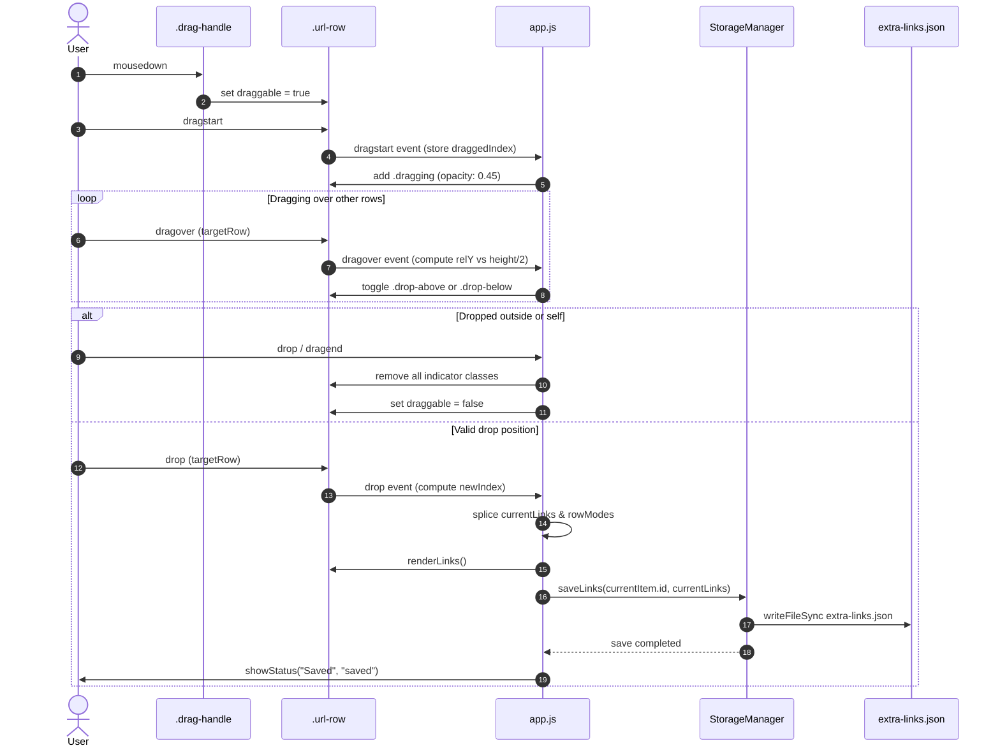

# Design Specification: Clickable Drag Handler & Link Sorting

## 1. UI Layout & Visual Hierarchy

The Eagle Extra Links Inspector displays links in a single-column vertical list. The drag handle is positioned at the leftmost edge of each row to form a consistent control gutter.

### 1.1 Inspector Row Structure

```
+-------------------------------------------------------------------------+
| [⋮⋮]  [T|U]  [ Documentation                     🔗]  [×]               |
+-------------------------------------------------------------------------+
   ^      ^                  ^                      ^    ^
   |      |                  |                      |    +-- Delete button
   |      |                  |                      +------- Open link button
   |      |                  +------------------------------ Text input (Title / URL)
   |      +------------------------------------------------- Mode toggle segmented button
   +-------------------------------------------------------- Drag grip handle (6-dot)
```

### 1.2 Visual States of the Drag Handle

| State | Cursor | Opacity / Color | Description |
| :--- | :--- | :--- | :--- |
| **Normal (Multiple rows)** | `grab` | `var(--text-secondary)` (~60%) | Ready to drag; clean 6-dot grip icon |
| **Hover (Multiple rows)** | `grab` | `var(--text-primary)` (100%) | Highlighted on mouse hover |
| **Active / Dragging** | `grabbing` | `var(--text-primary)` (100%) | Mouse button held down |
| **Disabled (Single row)** | `default` | `opacity: 0.35` | Visible grip icon indicating capability, but dimmed |

---

## 2. Drop Feedback: Option A (Accent Drop Line)

When dragging row 3 over row 1:

### 2.1 Dragging Over Upper Half (`.drop-above`)
```
      +=========================================================+ <--- 2px Accent Line (top: -2px)
      | [⋮⋮]  [T|U]  [ Row 1 (Hovered Target)             🔗]  [×] |
      +---------------------------------------------------------+
      | [⋮⋮]  [T|U]  [ Row 2                              🔗]  [×] |
      +---------------------------------------------------------+
      | [⋮⋮]  [T|U]  [ Row 3 (Active Dragging - 45% Opacity) 🔗]  [×] |
      +---------------------------------------------------------+
```

### 2.2 Dragging Over Lower Half (`.drop-below`)
```
      +---------------------------------------------------------+
      | [⋮⋮]  [T|U]  [ Row 1 (Hovered Target)             🔗]  [×] |
      +=========================================================+ <--- 2px Accent Line (bottom: -2px)
      | [⋮⋮]  [T|U]  [ Row 2                              🔗]  [×] |
      +---------------------------------------------------------+
      | [⋮⋮]  [T|U]  [ Row 3 (Active Dragging - 45% Opacity) 🔗]  [×] |
      +---------------------------------------------------------+
```

---

## 3. Interaction Sequence Diagram



---

## 4. Accessibility & Touch Safeguards

1. **Screen Readers**:
   - The drag handle has `aria-label="Drag to reorder"` and `title="Drag to reorder"`.
   - When disabled: `aria-disabled="true"` and `title="Single link cannot be reordered"`.
2. **Tab Navigation**:
   - The drag handle has `tabindex="0"`.
3. **Selection Safety**:
   - The drag handle uses `user-select: none`.
   - Double-clicking or selecting text inside `.url-input` never triggers a drag event.
