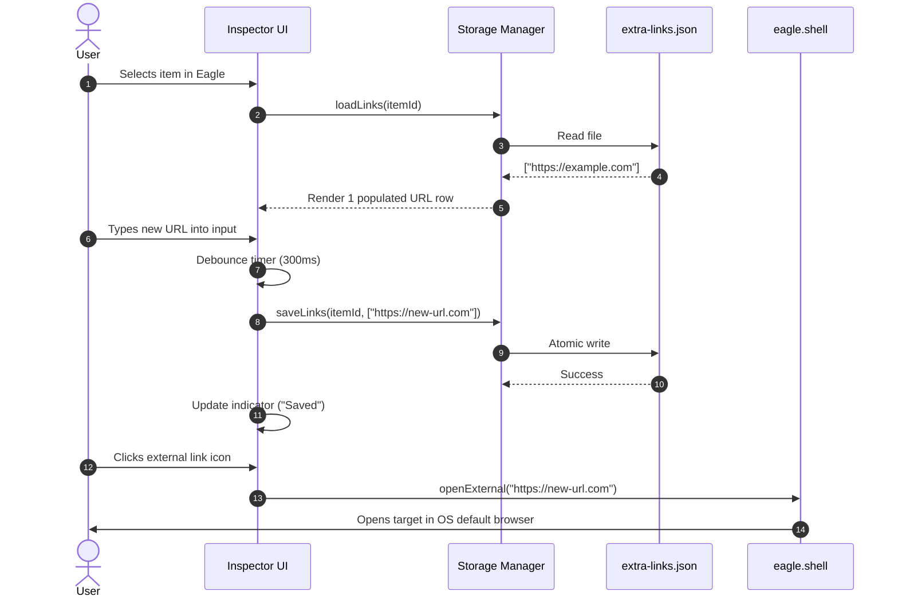
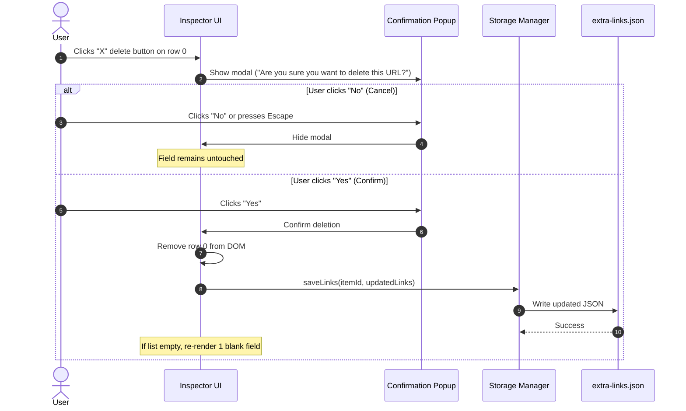
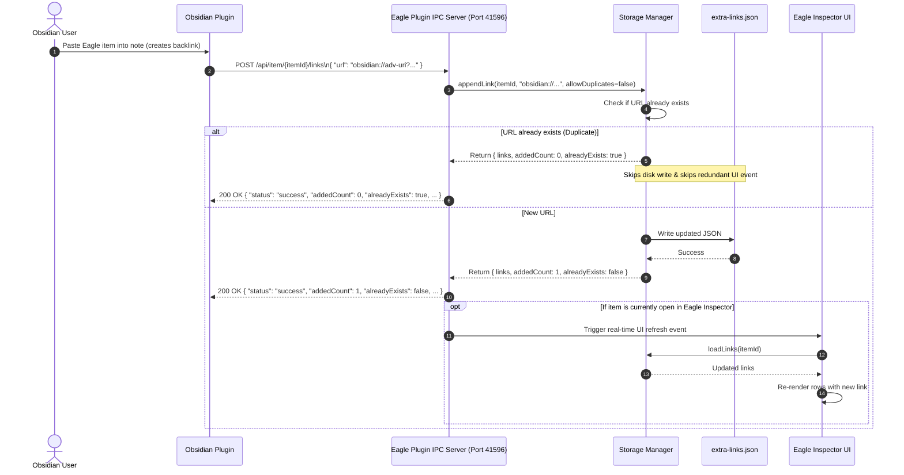

# Architecture & Design Document: Eagle Extra Links Plugin

## 1. System Architecture

### 1.1 Overview
The **Eagle Extra Links** plugin architecture comprises four decoupled subsystems:
1. **Inspector UI View**: The embedded WebView rendered within Eagle's right-hand Inspector panel.
2. **State & Storage Manager**: The file I/O layer that reads and writes `extra-links.json` sidecar files inside Eagle item directories.
3. **IPC Server**: A background Node.js HTTP server listening on loopback (`127.0.0.1:41596`) that handles incoming requests from external applications.
4. **Obsidian Integration Client**: The external caller (e.g. an Obsidian plugin) that interfaces with the IPC server or reads/writes the sidecar files directly.

```mermaid
flowchart TB
    subgraph Eagle_Host [Eagle Desktop Application]
        subgraph Inspector_Panel [Eagle Inspector Sidebar]
            Inspector_UI["Extra Links Inspector UI (index.html)"]
        end
        
        subgraph Plugin_Backend [Plugin Node.js Runtime]
            Storage_Manager["Storage Manager (storage.js)"]
            IPC_Server["IPC HTTP Server (ipc-server.js)"]
            Eagle_API["Eagle Plugin API (eagle.item, eagle.shell)"]
        end
        
        Library_Dir[("Eagle Library\n/images/{itemId}.info/")]
        Metadata_File["metadata.json (Untouched)"]
        Sidecar_File["extra-links.json (Persisted)"]
        
        Library_Dir --> Metadata_File
        Library_Dir --> Sidecar_File
    end

    subgraph External_App [Obsidian Desktop Application]
        Obsidian_Plugin["Obsidian Extra Links Plugin"]
    end

    Inspector_UI -->|DOM Events| Storage_Manager
    Inspector_UI -->|Open URL| Eagle_API
    Storage_Manager -->|Atomic Read/Write| Sidecar_File
    IPC_Server -->|Update Metadata| Storage_Manager
    IPC_Server -.->|Live UI Refresh Event| Inspector_UI
    Obsidian_Plugin -->|HTTP REST (Port 41596)| IPC_Server
    Obsidian_Plugin -.->|Direct Fallback Write| Sidecar_File
```

---

## 2. Component Design

### 2.1 Inspector UI Component (`index.html`, `js/app.js`)
The Inspector UI is responsible for rendering the controls, responding to user input, and communicating with Eagle's host APIs.

#### DOM Structure
```html
<div id="app" class="inspector-container">
    <!-- Header -->
    <div class="header">
        <span class="title">EXTRA LINKS</span>
        <div class="header-actions">
            <span id="save-status" class="save-status">Saved</span>
            <button id="settings-btn" type="button" class="icon-btn settings-btn" title="IPC Server Settings">
                <svg class="icon-gear" viewBox="0 0 24 24">...</svg>
            </button>
        </div>
    </div>

    <!-- Dynamic URL Rows -->
    <div id="url-list" class="url-list">
        <!-- Template for each row -->
        <div class="url-row" data-index="0">
            <div class="input-wrapper">
                <input type="text" class="url-input" placeholder="https://... or obsidian://..." value="...">
                <button type="button" class="icon-btn link-btn" title="Open URL in default app">
                    <svg class="icon-open" viewBox="0 0 24 24">...</svg>
                </button>
            </div>
            <button type="button" class="icon-btn delete-btn" title="Delete URL">
                <svg class="icon-delete" viewBox="0 0 24 24">...</svg>
            </button>
        </div>
    </div>

    <!-- Footer Controls -->
    <div class="footer">
        <button id="add-btn" type="button" class="btn-add">
            <svg class="icon-add" viewBox="0 0 24 24">...</svg>
            <span>Add URL</span>
        </button>
    </div>

    <!-- Confirmation Modal Dialog -->
    <div id="delete-modal" class="modal-backdrop hidden">
        <div class="modal-dialog">
            <div class="modal-title">Delete URL</div>
            <div class="modal-message">Are you sure you want to delete this URL?</div>
            <div class="modal-actions">
                <button id="modal-cancel-btn" type="button" class="modal-btn btn-secondary">No</button>
                <button id="modal-confirm-btn" type="button" class="modal-btn btn-danger">Yes</button>
            </div>
        </div>
    </div>

    <!-- IPC Settings Modal Dialog -->
    <div id="settings-modal" class="modal-backdrop hidden">
        <div class="modal-dialog settings-dialog">
            <div class="modal-title">IPC Server Settings</div>
            
            <div class="setting-item">
                <label class="toggle-label">
                    <span>Enable IPC Server</span>
                    <input type="checkbox" id="setting-server-enabled" checked>
                    <span class="toggle-slider"></span>
                </label>
            </div>

            <div class="setting-item">
                <label for="setting-host">Bind Host / IP (Required)</label>
                <input type="text" id="setting-host" class="setting-input" value="127.0.0.1" placeholder="127.0.0.1">
                <span class="setting-hint">Default: 127.0.0.1. Use 0.0.0.0 to allow LAN access.</span>
            </div>

            <div class="setting-item">
                <label for="setting-port">Port (Required)</label>
                <input type="number" id="setting-port" class="setting-input" value="41596" min="1024" max="65535" placeholder="41596">
                <span class="setting-hint">Default: 41596 (Valid range: 1024–65535)</span>
            </div>

            <div class="setting-item">
                <label class="toggle-label">
                    <span>Restrict Client Access</span>
                    <input type="checkbox" id="setting-restrict-access">
                    <span class="toggle-slider"></span>
                </label>
            </div>

            <div id="restriction-controls" class="setting-subgroup hidden">
                <label for="setting-allowed-clients">Allowed Clients (IP, Range, Hostname)</label>
                <input type="text" id="setting-allowed-clients" class="setting-input" placeholder="self, 192.168.1.*">
                <div class="chips-container">
                    <span class="chips-label">Suggestions:</span>
                    <button type="button" class="chip-btn" data-chip="self">+ self</button>
                    <button type="button" class="chip-btn" data-chip="127.0.0.1">+ 127.0.0.1</button>
                    <button type="button" class="chip-btn" data-chip="::1">+ ::1</button>
                    <button type="button" class="chip-btn" data-chip="192.168.1.x">+ 192.168.1.x</button>
                </div>
            </div>

            <div class="modal-actions">
                <button id="settings-cancel-btn" type="button" class="modal-btn btn-secondary">Cancel</button>
                <button id="settings-save-btn" type="button" class="modal-btn btn-primary">Save & Apply</button>
            </div>
        </div>
    </div>
</div>
```

#### Key UI Interactions:
1. **Mounting**: When `eagle.onPluginCreate` triggers, `app.js` fetches `eagle.item.getSelected()`. It calls `StorageManager.loadLinks(itemId)` and dynamically renders one or more `.url-row` elements.
2. **Editing**: Keystrokes in `.url-input` trigger a debounced save (300ms). The status indicator transitions from `Saving...` to `Saved`.
3. **Opening Link**: Clicking `.link-btn` reads the value of its paired input. If non-empty, it invokes `eagle.shell.openExternal(url)`.
4. **Deleting Link**: Clicking `.delete-btn` sets the target row index and displays `#delete-modal`.
   - Clicking "No" or pressing `Escape` hides the modal.
   - Clicking "Yes" removes the row from the DOM, flushes the new array to storage, and dismisses the modal.
5. **Configuring IPC Server**: Clicking `#settings-btn` opens `#settings-modal`.
   - Toggling "Restrict Client Access" reveals or hides the `#restriction-controls` and suggestion chips.
   - Clicking suggestion chips appends items (`self`, `127.0.0.1`, `::1`, `192.168.1.x`) to the allowed list.
   - Clicking "Save & Apply" validates fields, persists to `localStorage`, restarts/rebinds the IPC server, and dismisses the modal.

---

### 2.2 State & Storage Manager (`js/storage.js`)
The Storage Manager isolates all disk I/O operations and provides a clean Promise-based API for both the UI and IPC server.

#### Methods:
- `resolveItemInfoDir(itemId: string): Promise<string>`
  Resolves the path to `<LibraryPath>/images/<itemId>.info/`.
  - If `item.metadataFilePath` is available from the active Eagle item instance, it uses `path.dirname(item.metadataFilePath)`.
  - Otherwise, it queries `eagle.library.path` and constructs `path.join(libraryPath, 'images', `${itemId}.info`)`.
- `loadLinks(itemId: string): Promise<string[]>`
  Reads `<itemId>.info/extra-links.json`.
  - If the file exists, parses JSON and returns the `links` array.
  - If the file does not exist, returns an empty array `[]`.
- `saveLinks(itemId: string, links: string[]): Promise<boolean>`
  Atomic write of `links` array (including empty strings) to `extra-links.json`.
- `appendLink(itemId: string, newUrl: string): Promise<string[]>`
  Appends `newUrl` to the item's existing links, saves, and returns the updated array.
- `removeLinkByIndex(itemId: string, index: number): Promise<string[]>`
  Removes the link at `index`, saves, and returns the updated array.

#### JSON Storage Schema (`extra-links.json`)
```json
{
  "$schema": "http://json-schema.org/draft-07/schema#",
  "version": 1,
  "itemId": "MTSPUNN17LBUG",
  "links": [
    "https://www.artstation.com/artwork/example",
    "obsidian://adv-uri?vault=Main&filepath=Projects%2FConceptArt.md",
    ""
  ],
  "createdAt": 1788874771500,
  "updatedAt": 1788893048000
}
```

> **Empty Field Preservation**: As specified in REQ-5 and AC-5.2, if the user creates blank fields, they are explicitly saved as empty strings (`""`) in the `links` array. This preserves user-created blank slots across restarts.

---

### 2.3 IPC Server Component (`js/ipc-server.js`)
The IPC Server enables seamless, cross-platform external communication without third-party daemon processes or native binaries.

#### Server Lifecycle:
- **Initialization**: On plugin boot, reads configuration from `ConfigManager` (`js/config.js`).
- **Conditional Startup**: If `serverEnabled === true`, binds to configured `host` (default `127.0.0.1`) and `port` (default `41596`).
- **On/Off Toggle**: If `serverEnabled === false`, server does not listen. If toggled off while running, `server.close()` immediately terminates listening sockets.
- **Dynamic Reconfiguration**: When user modifies host, port, or access rules in Settings, the server cleanly closes existing connections and re-binds with updated options.
- **Graceful Shutdown**: Registers cleanup handlers on `eagle.onPluginBeforeExit` or window unload to close the port cleanly.

#### Access Control & IP Filter Middleware (`js/ip-filter.js`):
When `accessRestrictionEnabled === true`, every incoming socket connection is intercepted before route handling:
1. Extracts `req.socket.remoteAddress`. Handles IPv4-mapped IPv6 addresses (e.g. `::ffff:127.0.0.1` normalized to `127.0.0.1`).
2. Iterates over configured `allowedClients` whitelist:
   - `'self'`: Matches `127.0.0.1`, `::1`, `localhost`, and `::ffff:127.0.0.1`.
   - **Exact IP**: Direct string match against client IP.
   - **Wildcard / Subnet**: Matches wildcards like `192.168.1.*` or `192.168.1.x` by converting to subnet regex (`^192\.168\.1\.\d+$`).
   - **Hostname**: Matches against client reverse DNS or declared host.
3. **If Authorized**: Passes control to the REST request handler.
4. **If Rejected**: Returns HTTP 403 Forbidden with:
   ```json
   {
     "status": "error",
     "message": "Forbidden: Client IP 192.168.1.120 is not authorized."
   }
   ```
   Logs the rejection event to `eagle.log`.

#### REST API Specification

##### 1. Health Check
- **Endpoint**: `GET /health`
- **Response** (200 OK):
  ```json
  {
    "status": "ok",
    "version": "1.0.0",
    "library": "I:\\My Drive\\Eagle\\Main.library"
  }
  ```

##### 2. Retrieve Extra Links
- **Endpoint**: `GET /api/item/:id/links`
- **Parameters**: `:id` (Eagle item ID, alphanumeric string)
- **Response** (200 OK):
  ```json
  {
    "status": "success",
    "itemId": "MTSPUNN17LBUG",
    "links": [
      "https://example.com",
      "obsidian://adv-uri?vault=Main&filepath=Note.md"
    ]
  }
  ```
- **Error Response** (404 Not Found):
  ```json
  {
    "status": "error",
    "message": "Item directory not found for ID: MTSPUNN17LBUG"
  }
  ```

##### 3. Append Extra Link(s)
- **Endpoint**: `POST /api/item/:id/links`
- **Headers**: `Content-Type: application/json`
- **Request Body**:
  ```json
  {
    "url": "obsidian://adv-uri?vault=Main&filepath=Concept.md",
    "allowDuplicates": false
  }
  ```
  *(Or batch: `{ "urls": ["url1", "url2"], "allowDuplicates": false }`)*
- **Response** (200 OK - Link Added):
  ```json
  {
    "status": "success",
    "itemId": "MTSPUNN17LBUG",
    "links": [
      "https://example.com",
      "obsidian://adv-uri?vault=Main&filepath=Concept.md"
    ],
    "addedCount": 1,
    "alreadyExists": false
  }
  ```
- **Response** (200 OK - Duplicate Link Detected & Skipped):
  ```json
  {
    "status": "success",
    "itemId": "MTSPUNN17LBUG",
    "links": [
      "https://example.com",
      "obsidian://adv-uri?vault=Main&filepath=Concept.md"
    ],
    "addedCount": 0,
    "alreadyExists": true
  }
  ```

##### 4. Replace All Extra Links
- **Endpoint**: `PUT /api/item/:id/links`
- **Headers**: `Content-Type: application/json`
- **Request Body**:
  ```json
  {
    "links": [
      "https://artstation.com/ref",
      "obsidian://adv-uri?vault=Main&filepath=Ref.md"
    ]
  }
  ```
- **Response** (200 OK):
  ```json
  {
    "status": "success",
    "itemId": "MTSPUNN17LBUG",
    "links": [
      "https://artstation.com/ref",
      "obsidian://adv-uri?vault=Main&filepath=Ref.md"
    ]
  }
  ```

##### 5. Delete Extra Link
- **Endpoint**: `DELETE /api/item/:id/links`
- **Headers**: `Content-Type: application/json`
- **Request Body**:
  ```json
  {
    "index": 1
  }
  ```
  *(Or by URL match: `{ "url": "https://example.com" }`)*
- **Response** (200 OK):
  ```json
  {
    "status": "success",
    "itemId": "MTSPUNN17LBUG",
    "links": [
      "obsidian://adv-uri?vault=Main&filepath=Ref.md"
    ]
  }
  ```

---

## 3. Sequence Diagrams

### 3.1 User Editing Extra Links in Eagle Inspector


### 3.2 User Deleting a Field with Confirmation Modal


### 3.3 Obsidian Plugin Adding a URL via IPC (with Deduplication)


---

## 4. UI/UX Style Guide & Visual Specifications

### 4.1 Typography and Metrics
- **Base Font Family**: System sans-serif (`-apple-system, BlinkMacSystemFont, "Segoe UI", Roboto, Helvetica, Arial, sans-serif`).
- **Font Size**:
  - Section Header: `11px`, font-weight `600`, letter-spacing `0.5px`, uppercase.
  - URL Input Text: `12px`, font-weight `400`.
  - Buttons / Placeholders: `11px`.
- **Row Metrics**:
  - Input Height: `28px`.
  - Row Gap: `6px`.
  - Border Radius: `4px`.
  - Padding: `0 28px 0 8px` (right padding reserves space for the inline link icon).

### 4.2 Control Positioning
```
+-------------------------------------------------------------+
| EXTRA LINKS                                       Saved [⚙] |
|                                                             |
| +-----------------------------------------+--+   +-------+  |
| | https://my-reference-url.com/asset      |[]|   |   X   |  |
| +-----------------------------------------+--+   +-------+  |
|   ^ Editable text field                    ^         ^      |
|                                     Open link      Delete   |
|                                                             |
| +-----------------------------------------+--+   +-------+  |
| | obsidian://adv-uri?vault=Notes&uid=123  |[]|   |   X   |  |
| +-----------------------------------------+--+   +-------+  |
|                                                             |
| [+ Add URL]                                                 |
+-------------------------------------------------------------+
```

---

## 5. Error Handling & Safety Measures

1. **Port Collision Protection**:
   If port `41596` is already occupied by an existing process, the IPC server attempts to bind to `41597` or logs a descriptive notice without crashing the Inspector UI.
2. **Safe URL Launching**:
   Before calling `eagle.shell.openExternal`, input strings are trimmed and validated to have an acceptable protocol scheme (`http:`, `https:`, `obsidian:`, `notion:`, `file:`). Unsupported or potentially malicious script injection protocols (e.g. `javascript:`) are safely rejected.
3. **Atomic File Replacement**:
   When writing `extra-links.json`, the data is written safely to avoid zero-byte corruption during sudden system shutdowns or power losses.
