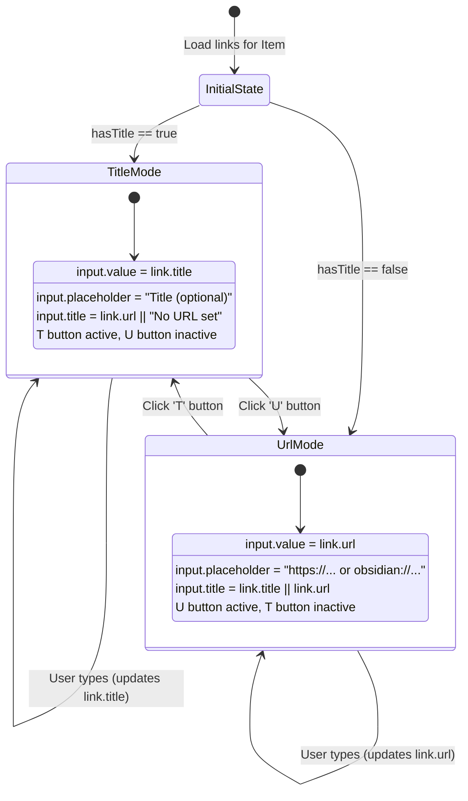
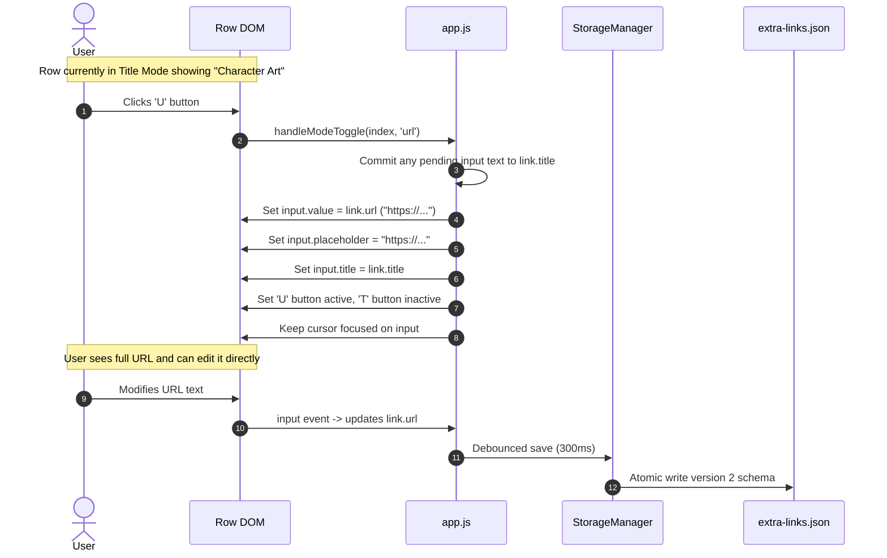
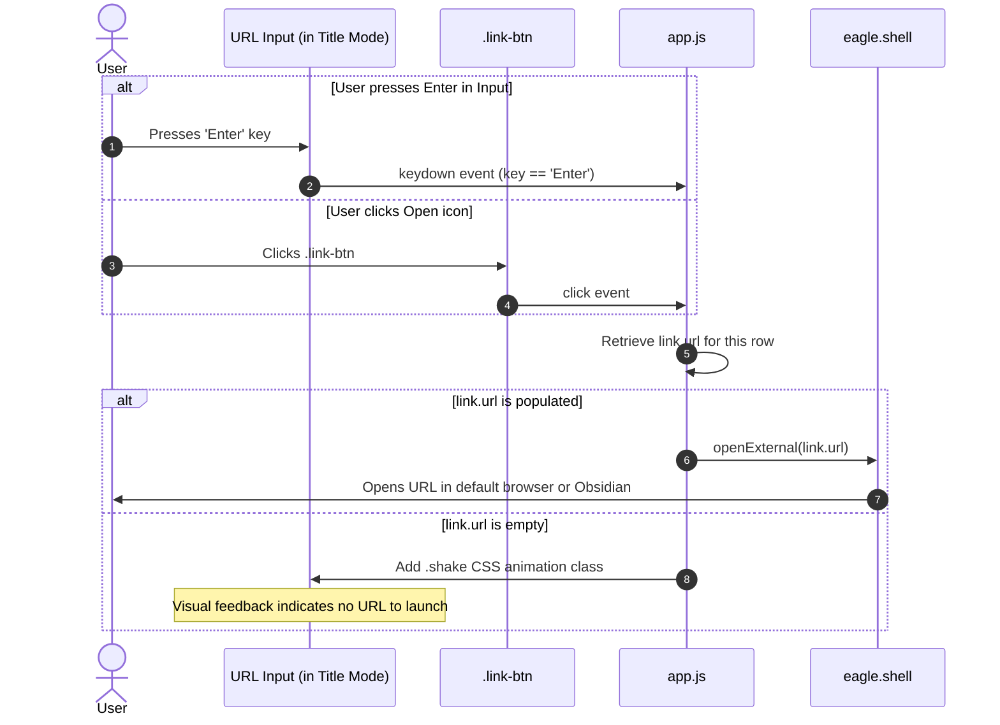
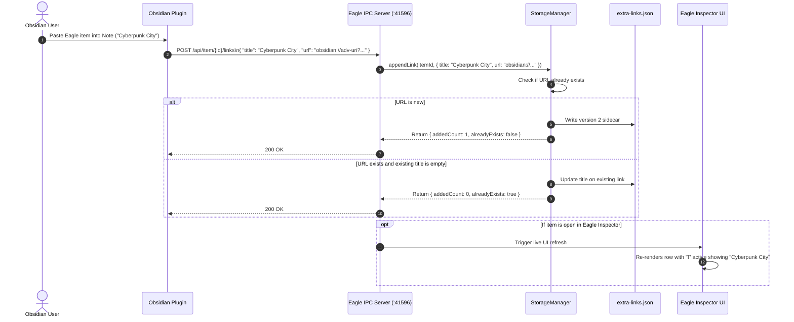

# System Design & UI/UX Specifications: Title and URL Display Modes

This document details the visual layouts, UI interaction patterns, sequence diagrams, and state machines for the **Title and URL Display Modes** feature in the **Eagle Extra Links** plugin.

---

## 1. UI Layout & Wireframe Specifications

### 1.1 Inspector Panel Overview
The Inspector panel renders each link as an interactive row equipped with a segmented mode control `[T|U]`, the text input field, an inline open button, and an outer delete button:

```
+-------------------------------------------------------------+
| EXTRA LINKS                                       Saved [⚙] |
|                                                             |
| +----+ +-------------------------------------+--+   +-------+ |
| |*T*|U| | Concept Art Reference               |[]|   |   X   | |
| +----+ +-------------------------------------+--+   +-------+ |
|   ^      ^ Input in Title Mode                 ^         ^    |
| Mode     (URL preview on hover)             Launch    Delete  |
| Toggle                                                        |
|                                                               |
| +----+ +-------------------------------------+--+   +-------+ |
| | T|*U*| | obsidian://adv-uri?vault=Main...    |[]|   |   X   | |
| +----+ +-------------------------------------+--+   +-------+ |
|   ^      ^ Input in URL Mode                                  |
|   U active (Title empty or user viewing URL)                  |
|                                                               |
| [+ Add URL]                                                 |
+-------------------------------------------------------------+
```

### 1.2 Title Mode vs URL Mode Comparison

#### Mode A: Title Mode (`T` Active)
- **Active Toggle**: `[T]` highlighted with theme primary accent (`--btn-primary-bg`), `[U]` subdued.
- **Input Content**: Displays human-readable label, e.g. `"Character Turnaround"`.
- **Placeholder**: `"Title (optional)"`
- **Hover State**: Hovering the cursor over the input reveals the native tooltip displaying the underlying URL:
  ```
  +----+ +-------------------------------------+--+
  |*T*|U| | Character Turnaround                |[]|
  +----+ +-------------------------------------+--+
         | https://artstation.com/artwork/ref  |  <-- Hover Tooltip
         +-------------------------------------+
  ```
- **Action**: Clicking `[]` or pressing `Enter` opens `https://artstation.com/artwork/ref`.

#### Mode B: URL Mode (`U` Active)
- **Active Toggle**: `[U]` highlighted with theme primary accent, `[T]` subdued.
- **Input Content**: Displays the actual target URL/URI, e.g. `"https://artstation.com/artwork/ref"`.
- **Placeholder**: `"https://... or obsidian://..."`
- **Hover State**: Hovering reveals the title (if one exists).
- **Action**: Clicking `[]` or pressing `Enter` opens the URL.

---

## 2. Row Mode State Machine

Each row operates on a local state machine that controls the active representation:



---

## 3. Sequence Diagrams

### 3.1 Toggling Display Mode Between Title and URL


### 3.2 Launching URL from Title Mode


### 3.3 Obsidian Plugin Adding Backlink with Note Title


---

## 4. Visual Styles & Theme Tokens

### 4.1 Button Group Metric Tokens
| Property | Value | Notes |
| :--- | :--- | :--- |
| Height | `28px` | Matches input height exactly |
| Button Width | `22px` each | Total width `44px` |
| Font Size | `10px` | Bold uppercase `T` and `U` |
| Gap / Divider | `1px` border | Separator between `T` and `U` |
| Border Radius | `4px` | Aligns with Eagle standard widget radius |

### 4.2 Theme Color Mapping
| Theme | Inactive Button Bg | Inactive Button Text | Active Button Bg | Active Button Text |
| :--- | :--- | :--- | :--- | :--- |
| `DARK` | `#2a2a2a` | `#888888` | `#3370ff` (Eagle Blue) | `#ffffff` |
| `GRAY` | `#333333` | `#999999` | `#3370ff` | `#ffffff` |
| `LIGHT` | `#f0f0f0` | `#777777` | `#2d8cf0` | `#ffffff` |
| `LIGHTGRAY` | `#e4e4e4` | `#666666` | `#2d8cf0` | `#ffffff` |
| `BLUE` | `#15202e` | `#7b97b8` | `#3f83d0` | `#ffffff` |
| `PURPLE` | `#1a1522` | `#9a84b3` | `#8952cc` | `#ffffff` |
